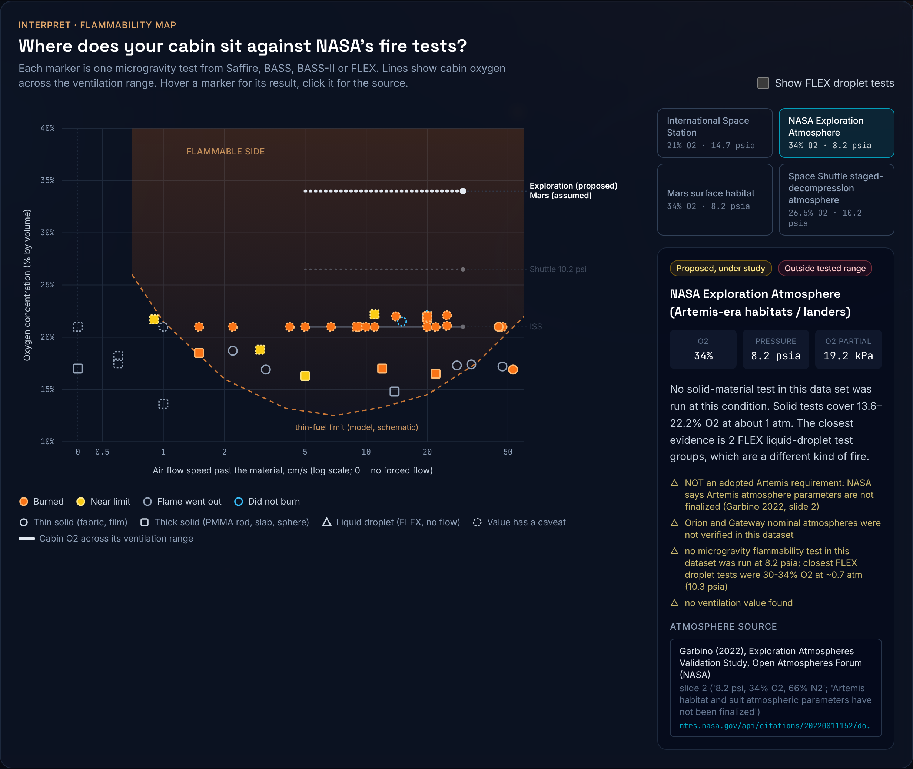
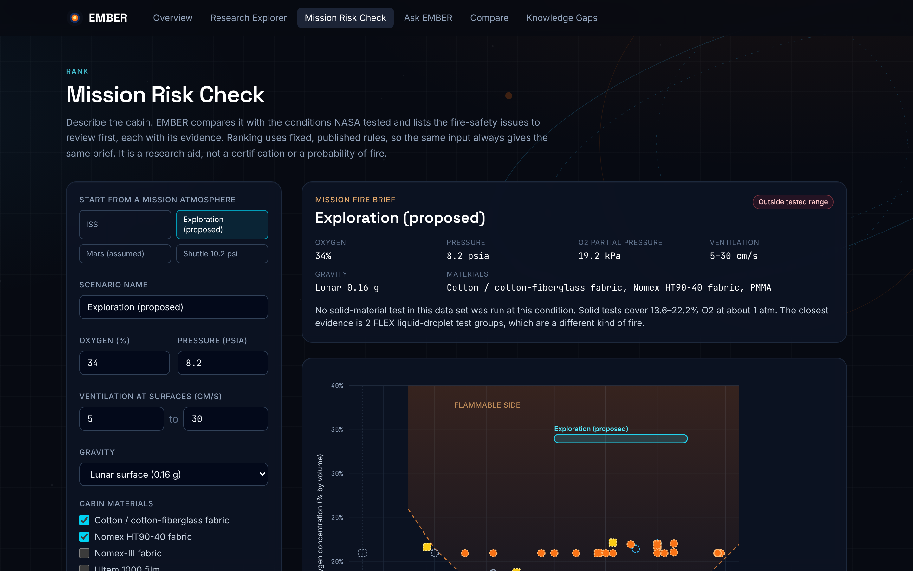

# EMBER · Flame in Freefall

**Evidence-backed Microgravity Burn Explorer & Risk advisor**

EMBER turns NASA's microgravity combustion research into fire-safety decisions for crewed spacecraft. It puts findings from Saffire, BASS, BASS-II, FLEX and SAME in one place, compares a mission's cabin atmosphere with the conditions NASA actually tested, and lists the issues a fire-safety engineer should review first, with every claim linked to its NASA source.

Built for the **NASA Space Apps Challenge 2026**, challenge _Flame in Freefall_.



> EMBER is a research and decision-support tool. It does not certify materials or spacecraft designs and does not give emergency instructions.

## Why

Fire behaves differently without gravity. With no buoyancy, hot gas does not rise, flames become slow and round, and smoke drifts instead of rising to a detector. NASA's flight experiments found that:

- materials can burn at 1 to 2.4 points lower oxygen in microgravity than in the Earth screening test;
- normal cabin ventilation (about 10 cm/s) is close to the airflow at which flames survive at the lowest oxygen;
- a directed nitrogen jet can feed a flame instead of putting it out;
- smoke from overheating is mostly sub-micron and reaches detectors later.

These results are spread across dozens of reports. Artemis-era habitats may also use an oxygen-enriched 34% O2, 8.2 psia atmosphere that no solid-material flight test has covered. EMBER makes both the evidence and its limits visible.

## What it does

| Challenge goal | Module                 | What the user gets                                                                                                                                                                                                                                                      |
| -------------- | ---------------------- | ----------------------------------------------------------------------------------------------------------------------------------------------------------------------------------------------------------------------------------------------------------------------- |
| Summarize      | **Research Explorer**  | Search and filter curated findings by hazard, experiment, material, mission and evidence type. Each finding separates the reported result, the conditions, the team's interpretation and the caveats, with the source document and page.                                |
| Rank           | **Mission Risk Check** | Enter oxygen, pressure, ventilation, gravity, materials, suppression and detection. Get a ranked list of issues to review, each with its triggering factors, a comparison with the closest NASA test and the evidence. Exports as a printable Mission Fire Brief (PDF). |
| Interpret      | **Flammability Map**   | 72 flight test conditions plotted as oxygen against airflow, with mission cabin atmospheres overlaid and an explicit "outside tested range" verdict.                                                                                                                    |
| Interpret      | **Ask EMBER**          | Questions in plain language, answered only from the knowledge base, with a clickable citation on every claim and an explicit "insufficient evidence" answer when the records do not cover the question.                                                                 |
| Explore        | **Compare**            | Up to three materials side by side, with warnings when test conditions are not comparable.                                                                                                                                                                              |
| Interpret      | **Knowledge Gaps**     | What NASA has not tested yet (lunar and Martian gravity, the 34% O2 atmosphere, large-scale suppression), with a proposed experiment for each.                                                                                                                          |



### Two-minute demo path

1. **Overview**: select _NASA Exploration Atmosphere_ on the map and read the "outside tested range" verdict.
2. **Research Explorer**: open finding `F10` (nitrogen jet) and follow the source link.
3. **Ask EMBER**: ask _"Does turning off cabin ventilation help put out a fire?"_ and open a citation.
4. **Mission Risk Check**: start from the Exploration preset, review the top five issues and export the brief.
5. **Knowledge Gaps**: see which mission conditions have no flight data at all.

## Data

All findings and test points come from NASA sources:

- **NASA Physical Sciences Informatics (PSI)**: SAFFIRE-I/II/III (PSI-98, 99, 100), BASS (PSI-26), BASS-II (PSI-25), FLEX (PSI-69), FLEX-2 (PSI-68), SAME (PSI-102), SAME-R (PSI-101).
- **A Researcher's Guide to: Combustion Science**, NASA ISS Program Science Office, 2015.
- **NASA Technical Reports Server**: Urban et al. 2017 (Saffire, 20180005168), Ferkul et al. 2013 (BASS, 20140011099), Dietrich et al. 2015 (FLEX, NASA/TP-2015-216046), Garbino 2022 and Norcross et al. 2013 (exploration atmospheres).
- A few BASS-II limits from conference and journal papers by the NASA experiment teams (ICES-2019-101, Link et al. 2018), cited with page numbers.

| File                                                       | Contents                                                                                                  |
| ---------------------------------------------------------- | --------------------------------------------------------------------------------------------------------- |
| [`src/data/findings.json`](src/data/findings.json)         | 28 findings with experiment, conditions, safety note, evidence type, relevance rating and source location |
| [`src/data/flammability.json`](src/data/flammability.json) | 72 flight test conditions, 9 reference limits and 7 mission atmospheres                                   |

Data limitations are shown in the interface and listed in [docs/data.md](docs/data.md). The most important: all solid-material flight tests ran at about 1 atm and 13.6 to 22.2% O2, nothing covers partial gravity, and the 8.2 psia / 34% O2 atmosphere is a NASA proposal, not an adopted Artemis requirement.

## How it works

```
                ┌──────────────────────── browser (React) ────────────────────────┐
 findings.json ─┤ Explorer · Map · Risk Check · Compare · Gaps                     │
 flammability ──┤   └─ search.ts (BM25)   risk.ts (rules)   coverage.ts             │
     .json      └──────────────────────────────┬────────────────────────────────────┘
                                               │ POST /api/ask
                ┌──────────── serverless function (Vercel) ───────────────────────┐
                │ validate → retrieve (same BM25 index) → LLM with evidence only   │
                │ → strip citations not in the retrieved set → JSON response        │
                │ fallback: retrieved records only, or "insufficient evidence"     │
                └──────────────────────────────────────────────────────────────────┘
```

- **Ranking is rule-based.** Each rule in [`src/lib/risk.ts`](src/lib/risk.ts) ties a scenario condition to documented evidence and assigns a tier (_Review first_, _Review_, _Note_). The same input always gives the same brief. There are no probabilities or numeric risk scores, because the data cannot support them.
- **Retrieval is lexical.** With a few dozen short records, BM25 with field weights and a small domain synonym table is accurate, fast and easy to audit, and needs no embedding service.
- **The language model only explains.** It receives the retrieved records and must cite a record id after every factual sentence. The server removes any citation that is not in the retrieved set. Without an API key, or if the provider fails, the page shows the retrieved records instead.

More detail: [docs/architecture.md](docs/architecture.md).

## Getting started

Requirements: Node.js 22 or newer.

```bash
npm install
cp .env.example .env.local   # optional: add ANTHROPIC_API_KEY for Ask EMBER
npm run dev                  # http://localhost:5173
```

The development server also serves `/api/ask`. Without an API key, Ask EMBER still works in records-only mode.

| Command             | Purpose                                                     |
| ------------------- | ----------------------------------------------------------- |
| `npm run dev`       | Development server with the API route                       |
| `npm test`          | Unit tests (data validation, retrieval, citations, ranking) |
| `npm run typecheck` | TypeScript project check                                    |
| `npm run build`     | Production build into `dist/`                               |

### Environment variables

| Name                | Required       | Description                                                        |
| ------------------- | -------------- | ------------------------------------------------------------------ |
| `ANTHROPIC_API_KEY` | For AI answers | Server-side only. Never exposed to the browser.                    |
| `EMBER_MODEL`       | No             | Overrides the model used by Ask EMBER (default `claude-opus-5-5`). |

## Deployment

The app deploys to Vercel's free tier with no extra configuration:

1. Import the repository in Vercel. The Vite preset is detected automatically.
2. Under **Settings → Environment Variables**, add `ANTHROPIC_API_KEY`.
3. Deploy. Static pages are served from `dist/` and `api/ask.ts` runs as a serverless function. `vercel.json` rewrites client routes to `index.html`.

## Project structure

```
api/ask.ts                 research assistant endpoint
src/data/                  NASA-derived data files
src/lib/                   data loaders, search, risk rules, coverage, assistant logic
src/components/            map, evidence lists, cards, shared UI
src/pages/                 one file per page
tests/                     Vitest unit tests
docs/                      architecture and data notes
```

## Known limitations and next steps

- The knowledge base is a curated subset of NASA research. Next: add SAME-R results, Saffire IV–VI and the ACME gaseous-flame investigations.
- No flight data exists for lunar or Martian gravity; the app marks these scenarios as outside the evidence rather than estimating them.
- The relevance rating (1 to 5) on each finding is the team's editorial judgement.
- The model boundary on the map is schematic: only two values are labelled in the source figure.

## License

[MIT](LICENSE). NASA data is used under NASA's media and data usage guidelines. EMBER is not affiliated with or endorsed by NASA.
